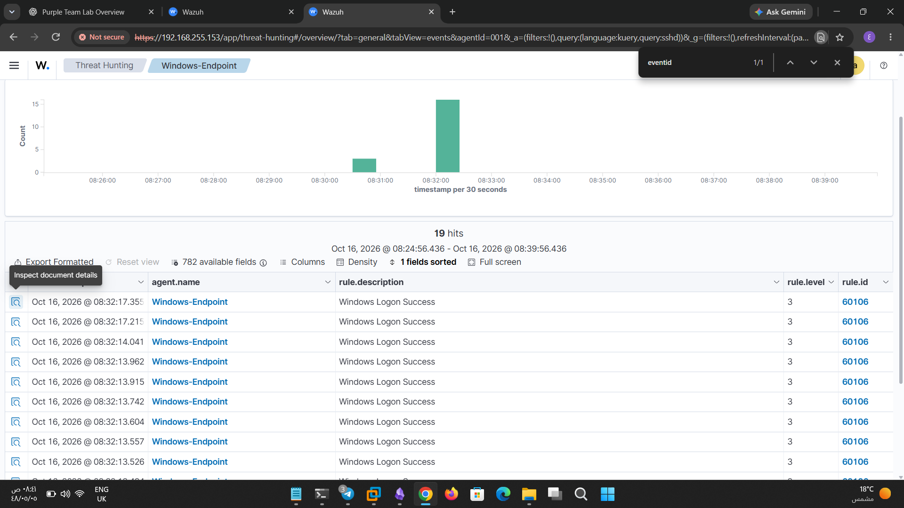
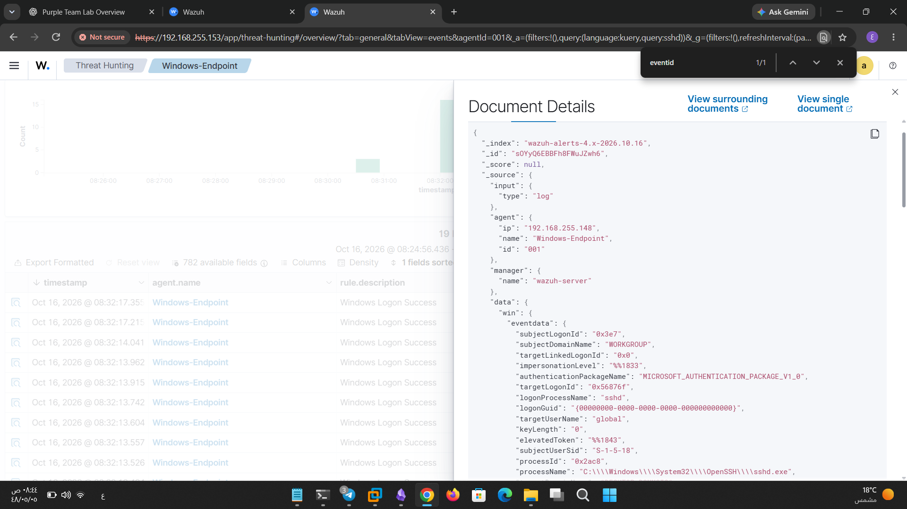

# SSH Password Guessing Detection — Blue Team Report

## 1. Executive Summary

This report documents the investigation of a controlled SSH password-guessing test performed in an isolated lab environment.

Hydra was used from Kali Linux to test authentication against a Windows SSH server. According to the recorded Hydra output, one valid credential pair was identified for the account `global`. Some worker connections did not complete, leaving the remaining attempts inconclusive.

The defensive investigation focuses on the available Wazuh alert and its associated JSON event to assess whether the authentication activity was recorded and detected.

The observed activity is mapped to the MITRE ATT&CK framework to classify the adversary behavior and support detection engineering.

| Field                | Details                            |
| -------------------- | ---------------------------------- |
| Report Type          | Blue Team Detection Report         |
| Incident / Test Name | SSH Password Guessing              |
| Target               | Windows SSH Server                 |
| Target IP            | `192.168.255.148`                  |
| Service              | SSH                                |
| Port                 | TCP/22                             |
| Account              | `global`                           |
| Attack Tool          | Hydra                              |
| Detection Platform   | Wazuh                              |
| Network Source       | Kali Linux                         |
| Test Result          | One valid credential pair reported |
| Investigation Scope  | Wazuh alert and JSON event         |
| Environment          | Authorized home lab                |

> **Scope note:** This report documents a controlled lab exercise, not a confirmed real-world security incident.

---

## 2. Objective

The objectives of this investigation are to:

- Investigate SSH password-guessing activity against a lab account.
    
- Examine the Wazuh alert associated with the test.
    
- Analyze the underlying JSON event and identify relevant evidence.
    
- Map the observed behavior to MITRE ATT&CK.
    
- Evaluate the available evidence and identify detection limitations.
    
- Recommend improvements to authentication security and monitoring.
    

---

## 3. Lab Environment

| Component                 | Details                    |
| ------------------------- | -------------------------- |
| Attacker                  | Kali Linux                 |
| Target Operating System   | Windows                    |
| Target IP                 | `192.168.255.148`          |
| Target Service            | OpenSSH / SSH server       |
| Network Port              | TCP/22                     |
| Attack Tool               | Hydra                      |
| SIEM / Detection Platform | Wazuh                      |
| Event Evidence            | Wazuh alert and JSON event |
| Account Under Test        | `global`                   |

---

## 4. Attack Scenario

### 4.1. Observed Activity

A controlled password-guessing test was performed against the SSH service using Hydra and a wordlist.

The recorded tool output reported one valid credential pair for the account `global`. Some worker connections did not complete, so the remaining attempts could not be conclusively evaluated.

### 4.2. Attack Sequence

1. The SSH service was targeted from Kali Linux.
    
2. Hydra attempted authentication using passwords from a wordlist.
    
3. The tool reported one valid credential pair for the account `global`.
    
4. The test output was reviewed to identify incomplete worker connections.
    
5. The Wazuh alert was examined for evidence of detection.
    
6. The corresponding JSON event was reviewed to identify supporting log fields.
    

### 4.3. Observed Result

| Observation                       | Finding                                       |
| --------------------------------- | --------------------------------------------- |
| Password-guessing test            | Performed                                     |
| Valid credential pair             | One reported by Hydra                         |
| Remaining attempts                | Inconclusive                                  |
| Wazuh alert                       | Available for investigation                   |
| JSON event                        | Available for investigation                   |
| Confirmed successful SSH session  | Must be verified from authentication evidence |
| Detection timestamp and source IP | Record from the actual event                  |

The Hydra result alone does not establish whether the credentials were subsequently used to establish an interactive SSH session.

---

## 5. Detection Evidence

### 5.1. Wazuh Alert

Insert the alert screenshot here.

The screenshot should document the actual Wazuh alert and, where available, show:

- Alert description.
    
- Wazuh rule ID.
    
- Alert severity level.
    
- Event timestamp.
    
- Target or agent information.
    
- Source IP address.
    
- Username.
    
- Authentication result or event description.
    

**Detection assessment:** The presence of a Wazuh alert provides evidence that an event was surfaced for investigation. Confirm that the alert corresponds to the SSH password-guessing test by comparing its timestamp, source, account, and event details.

Do not attribute the alert to Hydra solely because it appeared during the same general testing period.

### 5.2. Raw JSON Event

Insert the JSON screenshot here, directly after the Wazuh alert screenshot.

Review the event for the following fields, where available:

| Field              | Purpose                                                 |
| ------------------ | ------------------------------------------------------- |
| `timestamp`        | Establishes when the event was recorded                 |
| `rule.id`          | Identifies the Wazuh rule that generated the alert      |
| `rule.description` | Describes the detected event                            |
| `rule.level`       | Indicates the configured alert severity                 |
| `agent.name`       | Identifies the monitored agent                          |
| `data.srcip`       | May identify the source IP                              |
| `data.dstuser`     | May identify the targeted account                       |
| `data.srcuser`     | May identify the account, depending on the event source |
| `full_log`         | May contain the original authentication log             |
| `location`         | Identifies the log source or collection location        |

These are candidate fields, not a claim that all of them exist in the collected JSON. Use the actual field names and values from the event.

### 5.3. Evidence Correlation

Compare the Wazuh alert with the JSON event and the Hydra test record.

The investigation should establish:

1. Whether the alert timestamp overlaps with the test.
    
2. Whether the target account matches `global`.
    
3. Whether the event relates to SSH authentication.
    
4. Whether the source IP can be established from the logs.
    
5. Whether the event represents a failed login, successful login, or another SSH-related event.
    
6. Whether the alert and JSON record refer to the same event.
    

If the JSON contains only one authentication event, it may not be sufficient to prove that Wazuh detected the entire sequence of password-guessing attempts.

---

## 6. MITRE ATT&CK Mapping

The observed behavior can be mapped to MITRE ATT&CK as follows.

### 6.1. T1110 — Brute Force

**Tactic:** Credential Access

**Description:** Adversaries may attempt to obtain valid credentials by repeatedly testing authentication secrets.

**Relevance to this lab:** Hydra tested multiple candidate passwords against an SSH account. This is consistent with password-guessing behavior.

### 6.2. T1110.001 — Password Guessing

**Tactic:** Credential Access

**Technique:** Password Guessing

**Relevance to this lab:** A wordlist was used to test candidate passwords against the account `global`.

This is the most appropriate primary technique for the recorded test because the activity involved trying candidate passwords against an account.

**Evidence:**

- Hydra test output.
    
- SSH authentication events.
    
- Relevant Wazuh alert.
    
- Corresponding JSON event.
    

**Assessment:** The test procedure supports mapping the simulated behavior to T1110.001. The Wazuh evidence must be examined separately to determine whether the technique was detected successfully.

### 6.3. T1078 — Valid Accounts (Conditional)

**Tactic:** Defense Evasion, Persistence, Privilege Escalation, Initial Access — depending on how valid accounts are used.

**Relevance to this lab:** Hydra reported one valid credential pair.

However, the discovery of valid credentials does not prove that the credentials were subsequently used to access the target. Map observed authentication to T1078 only if the logs or other evidence confirm a successful login using those credentials.

### 6.4. Techniques Not Yet Established

Do not automatically map this test to the following techniques:

- **T1021.004 — SSH:** Requires evidence of SSH being used for remote services or access, beyond merely targeting the service with password attempts.
    
- **T1110.003 — Password Spraying:** Not the best fit for the described test, which involved testing multiple candidate passwords against a particular account.
    
- **T1059 — Command and Scripting Interpreter:** No command execution evidence has been provided.
    

MITRE ATT&CK mappings should reflect the behavior demonstrated by the evidence, not every technique that could theoretically follow a successful login.

---

## 7. Detection Logic and Investigation

### 7.1. Expected Detection Opportunities

Repeated SSH authentication failures may provide evidence of password-guessing activity.

Useful detection signals include:

- Multiple failed authentication attempts within a short period.
    
- Repeated attempts against the same account.
    
- Attempts against multiple accounts from a single source.
    
- A successful login following repeated failures.
    
- Authentication activity originating from an unexpected source.
    

A single failed-login alert may not independently establish password guessing. Correlating multiple events can provide stronger evidence.

### 7.2. Wazuh Investigation

Use the Wazuh Dashboard to inspect the relevant alert and its JSON event.

Verify:

- The actual Wazuh rule ID and description.
    
- The event timestamp and timezone.
    
- The target account and source address.
    
- The SSH authentication outcome.
    
- Whether related failures occurred before the alert.
    
- Whether a successful authentication event followed the failures.
    

If the Windows SSH service records authentication events in a log that Wazuh collects, review those records to corroborate the dashboard alert.

### 7.3. Detection Outcome

Classify the result using the evidence available:

- **Detected:** The alert and supporting event evidence correspond to the tested password-guessing activity.
    
- **Partially Detected:** Relevant events were recorded, but the available alerts did not adequately identify or represent the activity.
    
- **Not Detected:** Investigation of the relevant collected telemetry found no corresponding detection.
    
- **Inconclusive:** The evidence is insufficient to determine whether the test was detected.
    

Select the final classification only after verifying the screenshots and underlying event details.

---

## 8. Security Impact

Password guessing can result in unauthorized access when an attacker discovers a valid password for a reachable SSH service.

Potential consequences include:

- Unauthorized access to the targeted account.
    
- Access to files and services permitted by the account.
    
- Further compromise if the account has elevated privileges.
    
- Potential lateral movement if additional systems are accessible.
    

The actual impact depends on the account's privileges, the SSH server configuration, and whether the discovered credentials were used successfully.

No further compromise should be claimed without supporting evidence.

---

## 9. Recommendations

### 9.1. Authentication Hardening

- Enforce strong, unique passwords.
    
- Prefer SSH key-based authentication where appropriate.
    
- Disable password authentication when operationally feasible and after validating alternative access.
    
- Apply least privilege to SSH accounts.
    
- Review accounts that have unnecessary SSH access.
    

### 9.2. Network Restrictions

- Restrict TCP/22 to trusted hosts or approved management networks.
    
- Use host-based or network firewalls to limit SSH exposure.
    
- Review SSH access rules regularly.
    

### 9.3. Detection Improvements

- Collect and monitor SSH authentication logs in Wazuh.
    
- Alert on repeated failures against the same account.
    
- Detect repeated authentication attempts from the same source.
    
- Correlate repeated failures with subsequent successful logins.
    
- Review authentication anomalies against expected administration activity.
    
- Validate detection rules using controlled, repeatable tests.
    

### 9.4. Response Actions

If suspicious authentication is confirmed:

1. Validate the source, target account, and event timeline.
    
2. Determine whether a successful login occurred.
    
3. Review activity performed by the account after authentication.
    
4. Preserve relevant logs and evidence.
    
5. Reset exposed credentials or revoke affected access when appropriate.
    
6. Review the detection rule and improve monitoring if necessary.
    

---

## 10. Limitations

- Hydra reported one valid credential pair, but the remaining attempts were inconclusive because some worker connections did not complete.
    
- The original Hydra screenshot was not saved.
    
- The actual source IP, timestamp, Wazuh rule ID, and severity must be taken from the collected evidence.
    
- The presence of an alert does not, by itself, prove that the full password-guessing sequence was detected.
    
- The underlying JSON must be correlated with the test records to validate the alert's relevance.
    
- A successful credential check does not independently prove that a subsequent SSH session was established.
    

---

## 11. Conclusion

This lab exercise investigated SSH password-guessing activity against a Windows SSH server using Hydra. The recorded tool output reported one valid credential pair for the account `global`, while incomplete worker connections left the remaining attempts inconclusive.

The investigation uses the Wazuh alert and associated JSON event to assess defensive visibility and correlate the observed activity with the test.

The primary MITRE ATT&CK mapping is **T1110.001 — Password Guessing**, under the Credential Access tactic. Additional mappings, including T1078 — Valid Accounts, should only be applied when the relevant behavior is supported by evidence.

The exercise highlights the importance of strong authentication, restricted SSH access, centralized log collection, and correlation of authentication failures with subsequent successful logins.

---

  

