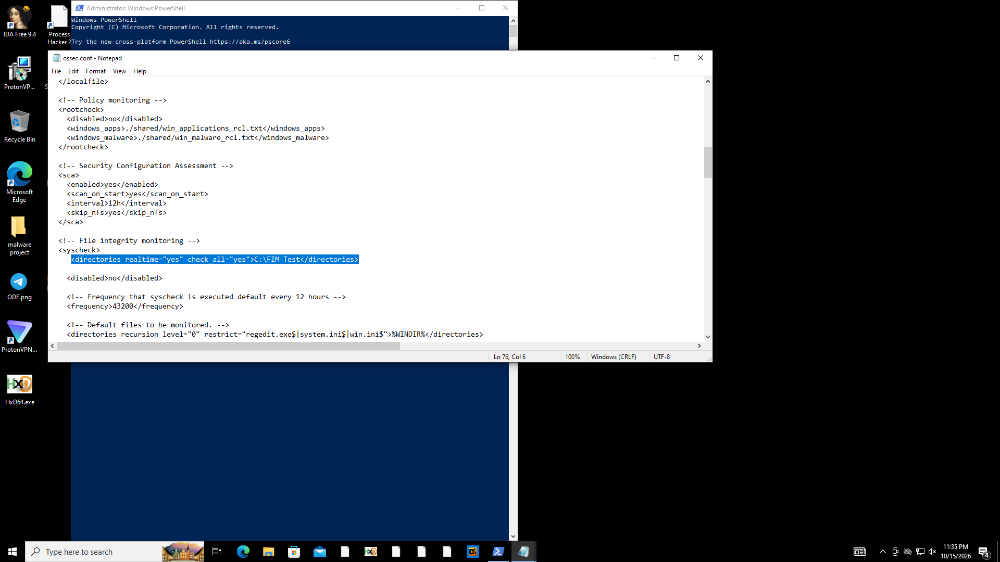
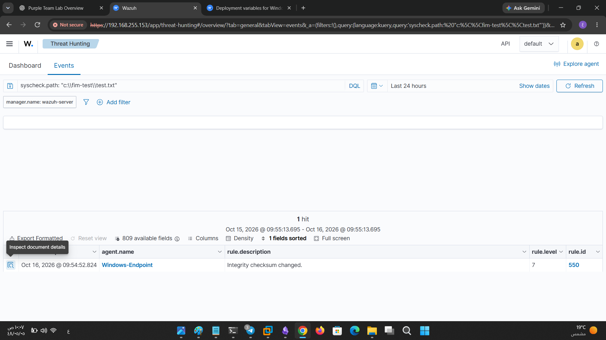
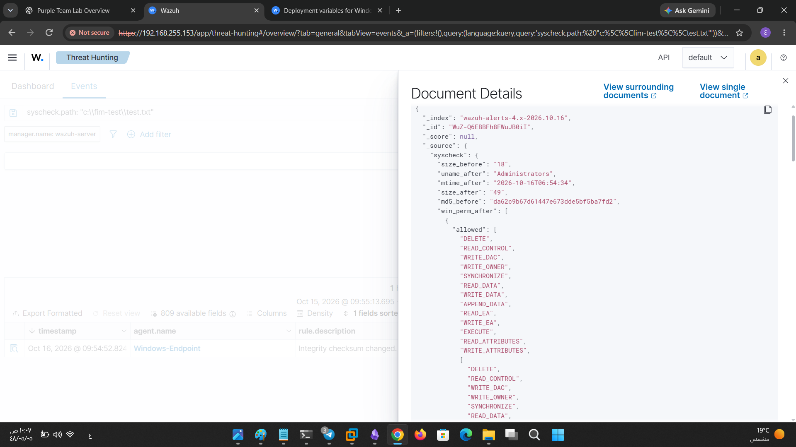

  
# Wazuh File Integrity Monitoring — Detection and Analysis
# Wazuh File Integrity Monitoring — Detection and Analysis

## 1. Overview

This investigation validates Wazuh File Integrity Monitoring (FIM) by modifying a test file on a Windows endpoint and analyzing the resulting security event.

The objective was to verify that real-time monitoring detected the modification and recorded file integrity information that could support security investigations.

## 2. Lab Environment

- **Endpoint:** Windows-Endpoint
    
- **Endpoint IP:** `192.168.255.148`
    
- **Agent ID:** `001`
    
- **Monitoring Platform:** Wazuh
    
- **Monitored File:** `c:\fim-test\test.txt`
    
- **Monitoring Mode:** Real-time FIM
    

## 3. FIM Configuration Validation

The Windows agent log confirmed that the test directory was configured for monitoring with real-time monitoring enabled.

The relevant configuration was:

```
<directories realtime="yes" check_all="yes">C:\FIM-Test\</directories>
```

The agent log reported the monitored path as `c:\fim-test`. It also confirmed that real-time file integrity monitoring had started.

The configured scheduled scan frequency was 43,200 seconds (12 hours). Real-time monitoring was separately enabled for the test directory.

**Evidence 1 — FIM Configuration**




_Figure 1: Wazuh FIM configuration for the test directory._

## 4. Detection Details

Wazuh generated an integrity monitoring alert after detecting a modification to the monitored file.

| Field             | Value                         |
| ----------------- | ----------------------------- |
| Alert description | `Integrity checksum changed.` |
| Rule ID           | `550`                         |
| Severity level    | `7`                           |
| Event             | `modified`                    |
| Monitoring mode   | `realtime`                    |
| Decoder           | `syscheck_integrity_changed`  |
| Agent             | `Windows-Endpoint`            |
| Agent IP          | `192.168.255.148`             |
| Agent ID          | `001`                         |
| File              | `c:\fim-test\test.txt`        |
| Event timestamp   | `2026-10-16 06:54:52.824 UTC` |
| Event ID          | `1792133692.66799318`         |
| Index             | `wazuh-alerts-4.x-2026.10.16` |

The alert was associated with the rule groups `ossec`, `syscheck`, `syscheck_entry_modified`, and `syscheck_file`.

**Evidence 2 — Wazuh Alert**



_Figure 2: Wazuh generated a level 7 alert after detecting a change to the monitored file._

## 5. File Integrity Comparison

The event recorded changes to five file attributes: `size`, `mtime`, `md5`, `sha1`, and `sha256`.

### 5.1 File Size and Modification Time

| Attribute         | Before                | After                 |
| ----------------- | --------------------- | --------------------- |
| File size         | 18 bytes              | 49 bytes              |
| Modification time | `2026-10-16 06:37:21` | `2026-10-16 06:54:34` |

The file size increased by 31 bytes. The recorded modification time also changed.

### 5.2 Cryptographic Hash Comparison

| Hash    | Before                                                             | After                                                              |
| ------- | ------------------------------------------------------------------ | ------------------------------------------------------------------ |
| MD5     | `da62c9b67d61447e673dde5bf5ba7fd2`                                 | `01efe633ecedcdc0a664576b49cc95bb`                                 |
| SHA-1   | `0dbd01defe20814eddd402cc2be79b12868c6cb7`                         | `95bdc286ae17b85ccf3f01151244e368b2ca4d15`                         |
| SHA-256 | `0b180c2b599687adcc28253ddda5b1c8d341e07dcf1eb5175c946677f0c70b45` | `cdd542da867083809cfa6e8b459d5955244f1c8c6e09239f115ea0f7e936b278` |

All three recorded hash values changed between the previous and current file states. These differences support the finding that the file contents or recorded file state changed.

**Evidence 3 — Hash and Attribute Changes**



_Figure 3: Wazuh recorded changes to the file's size, modification time, MD5, SHA-1, and SHA-256 values._

## 6. Detection Analysis

The event demonstrates that Wazuh FIM detected a modification to the monitored file and generated an alert with rule ID `550` and severity level `7`.

The increase in file size from 18 to 49 bytes, the change in modification time, and the differences in all three recorded hashes support the conclusion that the file's recorded state changed between the two observations.

The alert was mapped to MITRE ATT&CK technique **T1565.001 — Stored Data Manipulation**, under the Impact tactic. This mapping provides a behavioral classification; it does not independently prove malicious intent or adversary involvement.

The available evidence does not identify the person or process responsible for the modification.

## 7. Conclusion

**Detection Status: Successful.**

The test confirmed that:

- The Windows endpoint was connected to the Wazuh manager.
    
- The test directory was configured for real-time FIM monitoring.
    
- Wazuh detected the file modification.
    
- Rule `550` generated an alert at severity level `7`.
    
- The file size changed from 18 to 49 bytes.
    
- The modification time changed from `2026-10-16 06:37:21` to `2026-10-16 06:54:34`.
    
- The event recorded changes to the MD5, SHA-1, and SHA-256 values.
    

This validates the FIM detection workflow for the tested file modification scenario. It does not establish that every type of file change or every attack would be detected.

## 8. Event Reference

- **Index:** `wazuh-alerts-4.x-2026.10.16`
    
- **Event ID:** `1792133692.66799318`
    
- **Rule ID:** `550`
    
- **Agent ID:** `001`
    
- **Agent Name:** `Windows-Endpoint`
    
- **Agent IP:** `192.168.255.148`
    
- **File:** `c:\fim-test\test.txt`
    
- **Event Type:** `modified`
    
- **Detection Mode:** `realtime`
    
- **Severity:** `7`
    
- **Timestamp:** `2026-10-16T06:54:52.824+0000`
    


