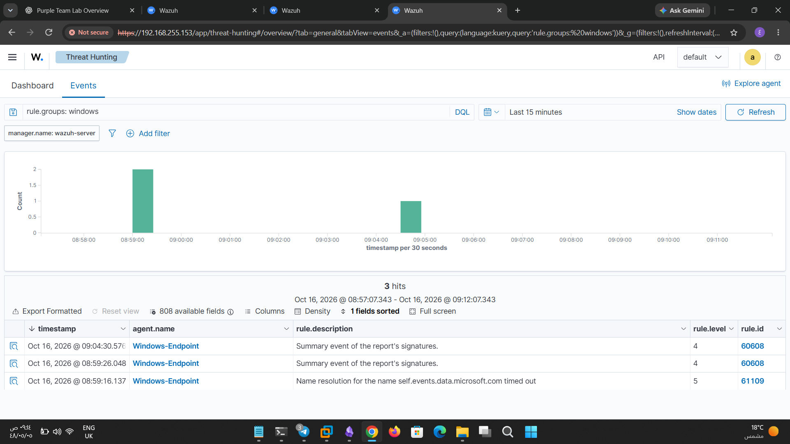
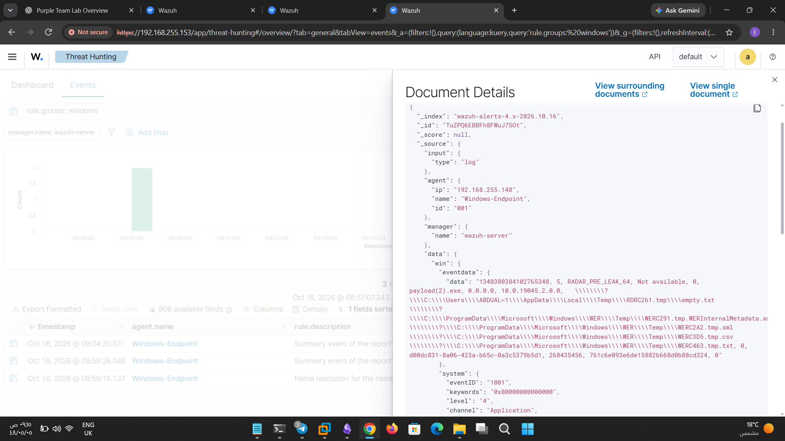

# Payload Detection and Analysis

## 1. Overview

This investigation examined the Windows events generated after executing `payload(2).exe` on the lab endpoint. The main objective was to review the available evidence in Wazuh and determine what could be confirmed from the collected logs.

## 2. Environment

| Component                | Details           |
| ------------------------ | ----------------- |
| Attacker Machine         | Kali Linux        |
| Target                   | Windows Endpoint  |
| Target IP                | `192.168.255.148` |
| SIEM                     | Wazuh             |
| File Under Investigation | `payload(2).exe`  |

## 3. Investigation Findings

After running the file, I reviewed the Wazuh Dashboard for events recorded around the test time.

I found a Windows Application event with Event ID `1001`, generated by the Windows Error Reporting provider. The event referenced `payload(2).exe` and included the report name `RADAR_PRE_LEAK_64`.

Wazuh assigned the event Rule ID `60608`, with an alert level of `4`.

### Screenshot 1 — Wazuh Alert

  

_Figure 1: Wazuh alert showing the Windows Error Reporting event associated with the test file._

## 4. Event Details

The raw JSON event provided the following information:

| Field         | Value                   |
| ------------- | ----------------------- |
| Event ID      | `1001`                  |
| Provider      | Windows Error Reporting |
| Channel       | Application             |
| Report Name   | `RADAR_PRE_LEAK_64`     |
| Reported File | `payload(2).exe`        |
| Wazuh Rule ID | `60608`                 |
| Alert Level   | `4`                     |

### Screenshot 2 — Raw JSON Event

  

_Figure 2: Raw JSON event showing the Windows Error Reporting details and the referenced filename._

## 5. Analysis

The collected event confirms that Windows generated an Application log entry referencing `payload(2).exe`, and Wazuh processed the event into an alert.

The report name `RADAR_PRE_LEAK_64` is associated with Windows Error Reporting diagnostics. Its presence does not, by itself, establish that the file performed malicious activity.

The alert was useful for identifying an event associated with the test, but it should not be treated as proof of malware detection. During this test, a successful Meterpreter connection was not confirmed.

To determine what happened during execution, the event would need to be correlated with additional evidence, such as process creation records, application crash details, and network connection events around the same timestamp.

## 6. Limitations

- The available evidence consists of a Windows Error Reporting event and its corresponding Wazuh alert.
    
- The event does not independently confirm successful payload execution or establish the cause of the reported error.
    
- No successful Meterpreter connection was confirmed.
    
- Additional endpoint and network telemetry would be required to determine whether the file initiated a connection or triggered other suspicious behavior.
    

## 7. Conclusion

Wazuh collected and alerted on a Windows Error Reporting event referencing `payload(2).exe`. The event provided a useful starting point for investigating the test, but the available evidence was not sufficient to confirm a successful Meterpreter connection or establish that the payload was detected as malware.

The next step is to correlate the event timestamp with Windows process logs and available network telemetry to determine whether any additional activity occurred during execution.