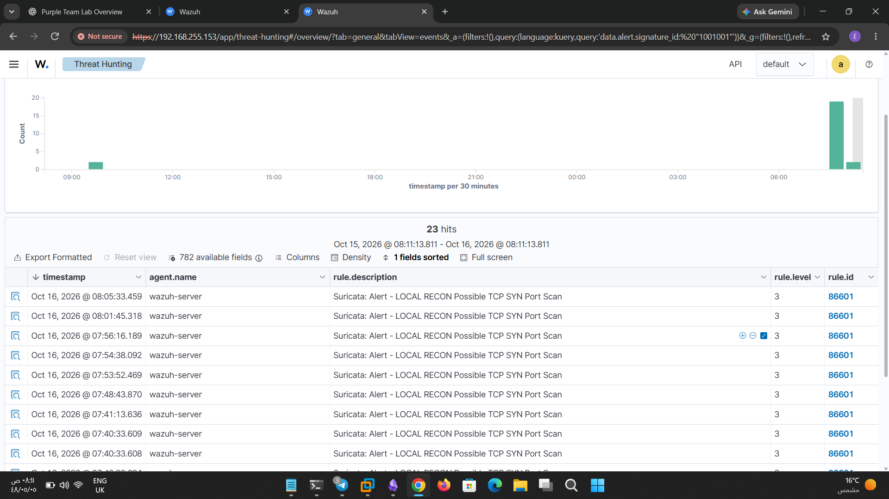
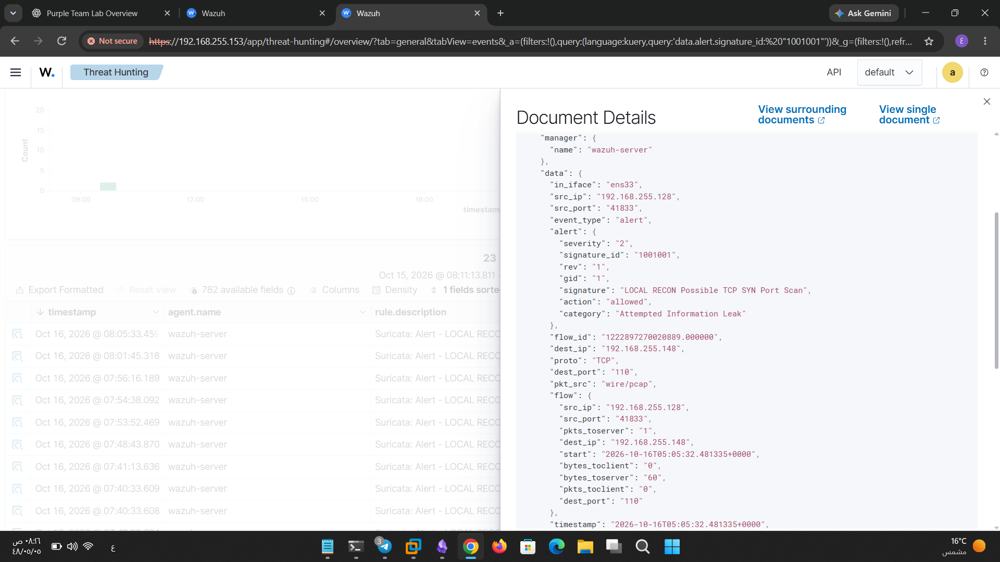

# Nmap Port Scan Detection

## 1. Objective

Verify whether Suricata detects TCP SYN scanning activity and whether Wazuh processes and displays the resulting security alert.

---

## 2. Detection Rule

| Field             | Value                                    |
| ----------------- | ---------------------------------------- |
| Detection Tool    | Suricata                                 |
| Suricata SID      | `1001001`                                |
| Wazuh Rule ID     | `86601`                                  |
| Alert Signature   | `LOCAL RECON Possible TCP SYN Port Scan` |
| Alert Level       | `3`                                      |
| Event Source      | Suricata `eve.json`                      |
| SIEM / Monitoring | Wazuh                                    |

---

## 3. Detection Workflow

The detection process follows these steps:

1. **Network Monitoring:** Suricata monitors network traffic on the configured lab interface.
    
2. **Rule Matching:** The local Suricata rule identifies TCP SYN traffic matching its detection conditions.
    
3. **Alert Generation:** Suricata records the matching event in `eve.json`.
    
4. **Event Collection:** Wazuh collects and processes the Suricata JSON event.
    
5. **Alert Processing:** Wazuh generates an alert associated with rule ID `86601`.
    
6. **Dashboard Investigation:** The analyst searches the Wazuh Dashboard using the Suricata signature ID to locate the corresponding event.
    

### Detection Flow

```
Kali Linux
    |
    | TCP SYN Scan
    v
Lab Network Interface
    |
    v
Suricata Local Rule
SID: 1001001
    |
    v
eve.json
    |
    v
Wazuh Event Processing
Rule ID: 86601
    |
    v
Wazuh Dashboard
    |
    v
Alert Investigation
```

---

## 4. Evidence

### Screenshots

- **Nmap Scan Alert :**
- 
    
- **Port Scan Detection Alert:** 

    

### Evidence Checklist

- Nmap scan activity documented.
    
- Suricata alert located in the Wazuh Dashboard.
    
- Suricata signature ID verified.
    
- Corresponding Wazuh rule ID verified.
    
- Screenshot of the detection alert saved.
    

---

## 5. Analysis

The alert was located in the Wazuh Dashboard using the following search query:

```
data.alert.signature_id: "1001001"
```

### Findings

- The Suricata signature ID was identified as `1001001`.
    
- The corresponding Wazuh alert used rule ID `86601`.
    
- The alert was searchable in the Wazuh Dashboard.
    
- These findings confirm that the matching Suricata event was processed by Wazuh and made available for investigation.
    

### Analyst Interpretation

This test demonstrates the integration between network intrusion detection and centralized security monitoring.

Suricata identifies network traffic matching the local detection rule, while Wazuh makes the resulting event available for security analysis through its alerting and dashboard capabilities.

---

## 6. Limitations

- The alert confirms detection of traffic matching the configured local TCP SYN rule.
    
- It does not prove that every port scan will be detected.
    
- It does not establish that every scanned port was identified.
    
- Detection depends on the rule conditions, network visibility, interface configuration, and event collection pipeline.
    
- A Wazuh alert confirms event processing, but does not independently establish that the underlying activity was malicious.
    

---

## 7. Conclusion

The test demonstrated that Suricata generated a network detection event matching the local TCP SYN scanning rule and that Wazuh processed the event and made it searchable in the dashboard.

This validates the tested portion of the Suricata-to-Wazuh detection pipeline and provides evidence that the monitoring stack can support the investigation of port scanning activity.

---

## 8. Key Takeaways

- **Suricata:** Detects network traffic matching configured rules.
    
- `**eve.json**`**:** Stores Suricata events in JSON format.
    
- **Wazuh:** Processes collected events and makes applicable alerts searchable.
    
- **Signature ID:** Helps identify the Suricata detection that generated the event.
    
- **Wazuh Rule ID:** Identifies the Wazuh rule associated with the resulting alert.
    
- **Detection Validation:** Requires correlating the scan, alert details, and supporting evidence.
