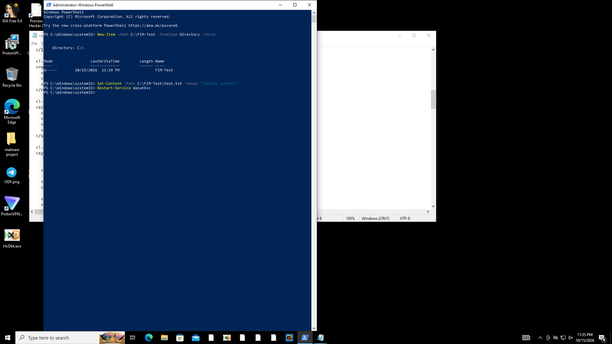

# File Modification Test — FIM Validation

## 1. Overview

This test simulated a file modification scenario on a Windows endpoint to validate whether the configured security monitoring system could detect changes to a monitored file.

The test was performed in a controlled lab environment using PowerShell to modify a test file monitored by Wazuh File Integrity Monitoring (FIM).

## 2. Lab Environment

| Component            | Details                          |
| -------------------- | -------------------------------- |
| Monitoring Platform  | Wazuh                            |
| Target               | Windows Endpoint                 |
| Target IP            | `192.168.255.148`                |
| Monitored Directory  | `C:\FIM-Test\`                   |
| Test File            | `C:\FIM-Test\test.txt`           |
| Tool                 | Wazuh File Integrity Monitoring  |
| Test Action          | File Modification                |
| Monitoring Mode      | Real-Time                        |
| Detection Rule ID    | `550`                            |
| Alert Level          | `7`                              |
| Monitored Attributes | Size, mtime, MD5, SHA-1, SHA-256 |

## 3. Test Procedure

A dedicated directory named `C:\FIM-Test` was created on the Windows endpoint. The Wazuh agent was configured to monitor this directory with real-time file integrity monitoring enabled.

The following PowerShell command was used to modify the test file:

```
Set-Content -Path "C:\FIM-Test\test.txt" -Value "Realtime test $(Get-Date -Format o)"
```

The command replaced the previous file contents with a new value containing the current timestamp.

### Evidence  — File Modification




_Figure 1: PowerShell command used to modify the test file on the Windows endpoint._

## 4. Test Results

The file modification was detected by Wazuh FIM. The event identified the file as modified and recorded changes to its size, modification time, and cryptographic hashes.

The resulting event referenced the following file:

`c:\fim-test\test.txt`


## 5. Outcome

**Result: Successful file modification detection test.**

The test confirmed that a controlled modification to the monitored file was detected by Wazuh. The event was recorded in real-time monitoring mode.

This test validates file integrity monitoring. It does not demonstrate a successful system compromise, unauthorized access, or exploitation of the Windows endpoint.

## 6. Scope and Limitations

- The test was performed on a dedicated test file.
    
- The observed result confirms detection of the file modification.
    
- The evidence does not establish who made the modification or whether it was malicious.
    
- No claim is made that Wazuh prevented the modification.
    

