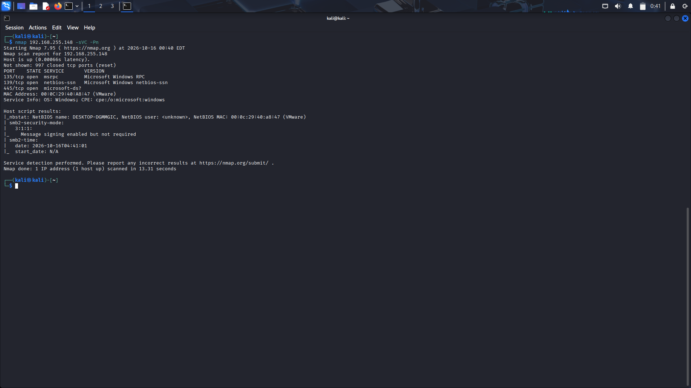

# Nmap Port Scanning

## 1. Objective

Perform a port scanning test from Kali Linux against the authorized lab target to identify exposed ports and verify whether the monitoring stack detects the scanning activity.

---

## 2. Environment

| Component  | Description        |
| ---------- | ------------------ |
| Attacker   | Kali Linux         |
| Monitoring | Suricata and Wazuh |
| Target     | Lab host           |
| Tool       | Nmap               |

---

## 3. Procedure

1. Execute an Nmap scan against the authorized lab target.
    
2. Record the exact scan command used.
    
3. Document the actual scan results, including discovered open ports and services.
    
4. Review Suricata alerts to determine whether the scanning activity was detected.
    
5. Review relevant Wazuh alerts and available logs, if applicable.
    
6. Record the findings and link the supporting evidence.
    

---

## 4. Evidence

**Screenshot:** 

- Nmap scan screenshot saved.
    
- Scan command documented.
    
- Discovered ports and services recorded.
    
- Suricata detection status verified.
    
- Relevant Wazuh logs or alerts reviewed.
    

---

## 5. Results

The port scanning activity was tested in the lab. Detection evidence and the corresponding defensive analysis are documented separately in the Blue Team report.

**Detection Status:** Refer to the verified findings in the Blue Team report.

---

## 6. Notes

- The scan command, target IP address, and discovered ports must match the actual test results.
    
- Record the date and time of the scan to support event correlation.
    
- Do not claim successful detection unless supported by relevant logs or alerts.
    
- If no alert was generated, investigate the available telemetry before concluding that the activity was not detected.
    

---
