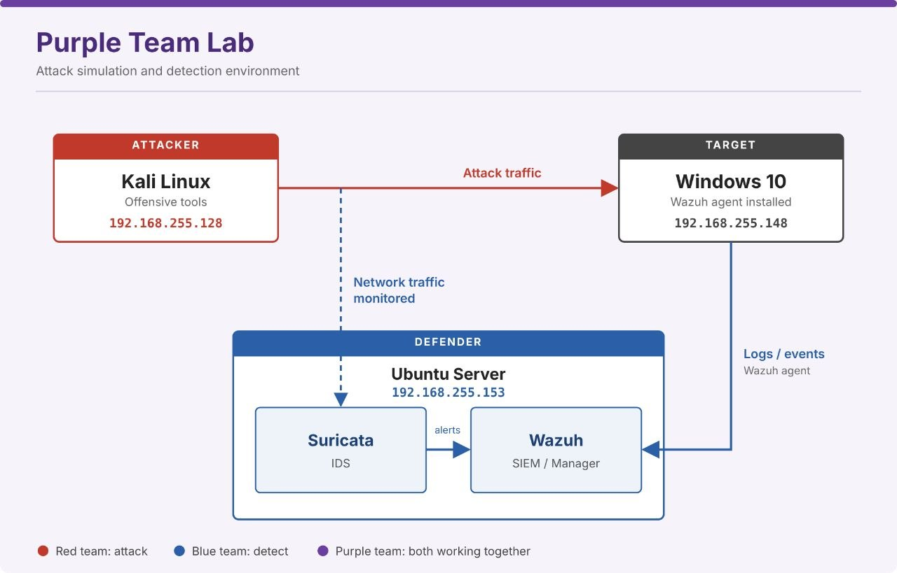

# Purple Team Lab

A hands-on Purple Team lab combining controlled security testing with defensive monitoring using Wazuh and Suricata.

## Lab Architecture

  

_Figure 1: Overview of the lab environment, testing endpoint, and security monitoring components._

## Overview

This repository documents practical exercises performed in a controlled lab environment. It covers selected security testing scenarios, defensive telemetry, and monitoring validation.

The focus is on understanding how testing activity appears in security tools, validating collected events, and documenting results based on available evidence.

## Lab Environment

| Component                  | Details                                       |
| -------------------------- | --------------------------------------------- |
| Lab Type                   | Purple Team                                   |
| Endpoint                   | Windows                                       |
| Endpoint IP                | `192.168.255.148`                             |
| SIEM & Endpoint Monitoring | Wazuh                                         |
| Network Monitoring         | Suricata                                      |
| Testing Tools              | Nmap, Hydra, Metasploit Framework, PowerShell |

## Project Contents

The repository contains individual files documenting the practical exercises, configurations, screenshots, and observations.

### Exercises

- **Network Reconnaissance:** Nmap testing and the associated Suricata alert collected by Wazuh.
    
- **SSH Password Guessing:** Hydra testing and documentation of the observed results.
    
- **Windows Payload Testing:** Examination of Windows application telemetry collected during the test.
    
- **File Integrity Monitoring:** Validation of Wazuh FIM through a controlled file modification.
    

Refer to the corresponding project files for the detailed steps, screenshots, configurations, and evidence for each exercise.

## Tools & Technologies

- **Wazuh:** Endpoint security monitoring, event collection, and File Integrity Monitoring.
    
- **Suricata:** Network threat detection and alert generation.
    
- **Nmap:** Network reconnaissance and service discovery.
    
- **Hydra:** Authorized password-guessing tests.
    
- **Metasploit Framework:** Controlled payload testing.
    
- **PowerShell:** Windows administration and lab operations.
    

## Learning Objectives

- Understand the relationship between security testing and defensive monitoring.
    
- Observe network and endpoint events generated during controlled exercises.
    
- Validate alerts against available telemetry.
    
- Configure and test File Integrity Monitoring.
    
- Practice documenting security activities and distinguishing confirmed findings from unverified results.
    

## Important Notes

All exercises were performed in a controlled lab environment.

The repository documents observed results and does not assume that every test resulted in successful execution or detection. Conclusions are limited to the evidence recorded in the relevant project files.

## References

- [Wazuh Documentation](https://documentation.wazuh.com/)
    
- [Suricata Documentation](https://docs.suricata.io/)
    
- [MITRE ATT&CK](https://attack.mitre.org/)
    

---

**Project Focus:** Purple Team | Security Testing | SIEM | Network Monitoring | Endpoint Detection